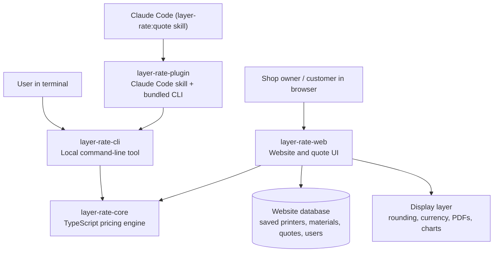
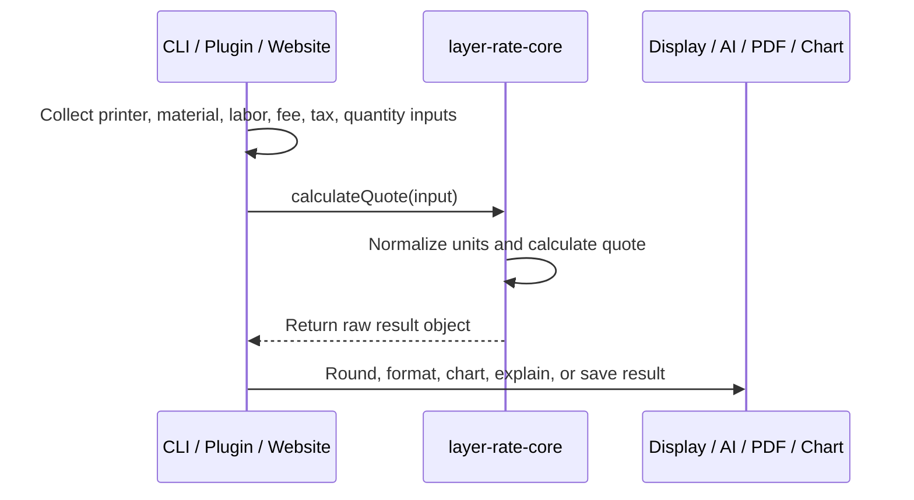

# LayerRate Architecture

## High-Level Model

LayerRate should be organized around one pricing source of truth:



The rule is simple: **pricing math lives only in `layer-rate-core`**. The CLI, Claude Code plugin, and website collect inputs, call the core, and present the result.

## Components

### `layer-rate-core`

Purpose:
- Calculates one quote.
- Supports materials, time, labor, machine cost, fees, tax, markup, and margin.
- Returns raw decimal numbers and detailed breakdowns.

Stack:
- TypeScript
- Node-compatible ESM package
- Vitest for tests

Does not handle:
- users
- saved printers/materials
- currency formatting
- rounding for display
- PDFs
- quote history
- ecommerce
- slicer import

Public API:

```ts
import { calculateQuote } from "layer-rate-core";

const result = calculateQuote(input);
```

### `layer-rate-cli`

Purpose:
- Developer/local tool to test quotes quickly.
- Useful before the website exists.
- Can read a JSON input file and print JSON/table output.

Recommended stack:
- TypeScript
- Node.js
- `commander` or `yargs` for commands
- `tsx` for local development

Example usage:

```sh
layer-rate quote ./examples/lightbox.json
layer-rate quote ./examples/lightbox.json --format table
```

How it uses core:
- Parses user input from JSON or flags.
- Calls `calculateQuote(input)`.
- Formats output for terminal.

### `layer-rate-plugin`

Purpose:
- Prices 3D print jobs from inside Claude Code.
- A `layer-rate:quote` skill gathers job details and runs the calculator.

Stack:
- Claude Code plugin with a Markdown skill
- The CLI bundled into one file with rolldown (`cli/layer-rate.mjs`), so no separate install
- Plugin `userConfig` for shop settings, asked once and editable in `/config`
- Node.js 20+ on the user's machine
- No MCP server

Example command the skill runs:

```sh
node "${CLAUDE_PLUGIN_ROOT}/cli/layer-rate.mjs" quote --stdin --compact-json
```

How it uses core:
- Only through the bundled CLI. It never re-implements formulas.

### `layer-rate-web`

Purpose:
- Main user-facing product.
- Saves printers, materials, labor defaults, quote history, and customer-facing views.
- Provides forms, charts, PDFs, and quote sharing.

Recommended stack:
- Next.js
- TypeScript
- React
- Tailwind CSS
- PostgreSQL with Prisma or Drizzle
- Auth.js or Clerk for accounts
- Stripe later if paid features are needed

How it uses core:
- UI collects or loads saved defaults.
- Server action/API route builds a `LayerRateQuoteInput`.
- Calls `calculateQuote(input)`.
- UI formats raw output into cards, charts, PDFs, and customer messages.

## Recommended Repository Organization

Start as a monorepo while the project is young:

```txt
b3dp/
  PROJECT_IDEAS.md
  LAYER_RATE_ARCHITECTURE.md
  layer-rate-core/
  layer-rate-cli/
  layer-rate-plugin/
  layer-rate-web/
```

This keeps all related packages easy to change together. If any part grows independently later, it can be moved to its own repository.

## Data Flow



## Boundary Rules

- Core owns math.
- CLI owns terminal input/output.
- Plugin owns Claude Code skills, shop settings, and the bundled CLI copy. It calls the CLI, never core directly.
- Website owns users, saved data, formatting, charts, PDFs, and ecommerce.
- No other component should duplicate pricing formulas.
- Display rounding happens outside core.
